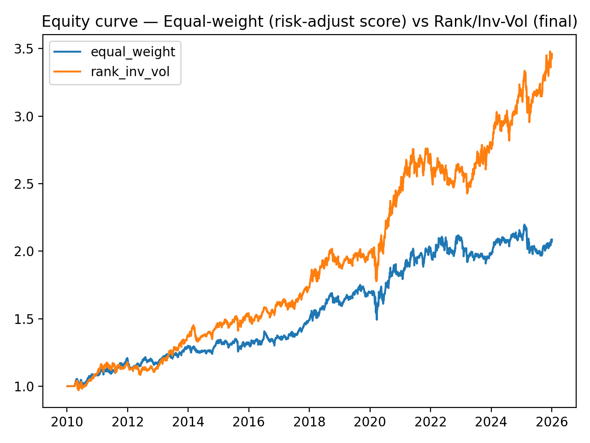
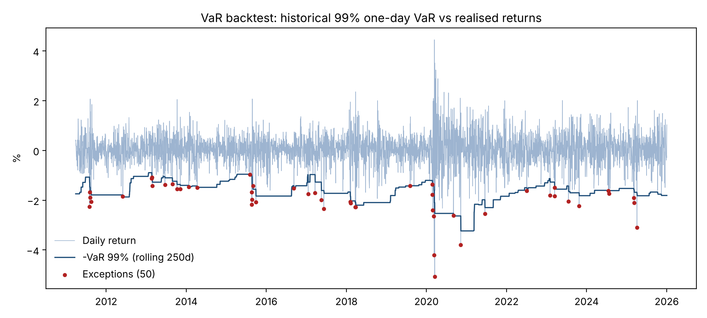
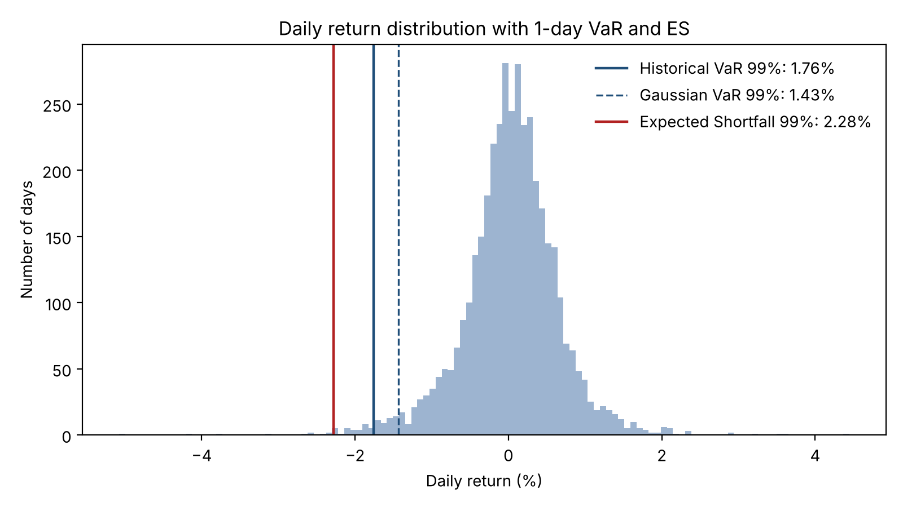

# Cross-Sectional Momentum: Long/Short Strategy on US Large Caps

*Version française : [README.fr.md](README.fr.md)*

A monthly long/short equity strategy on ~100 US large caps (2010 to today), built in Python, with a full robustness study (out-of-sample test, sensitivity grid, ablation, sub-periods, CAPM / Fama-French regressions) and a market risk report (VaR, Expected Shortfall, Stressed VaR, VaR backtesting, historical stress tests).

## Key results

Backtest from April 2010 to January 2026 (last run), net of 8 bps transaction costs on turnover.

| | Full period | Out-of-sample 2020–2024* |
|---|---|---|
| Annualised return (CAGR) | 8.1% | 10.3% |
| Annualised volatility | 9.9% | 10.8% |
| Sharpe ratio (rf = 0) | 0.83 | 0.96 |
| Maximum drawdown | −12.3% | −12.1% |
| Average net / gross exposure | +40% / 100% | +40% / 100% |
| 1-day VaR 99% (historical) | 1.76% | 1.77% |
| 1-day Expected Shortfall 99% | 2.28% | 2.31% |

\*The out-of-sample backtest starts trading in April 2020, after its 60-day warm-up (see Limitations).



## Strategy

**Universe.** About 100 of the largest US stocks (an extended S&P 100), daily adjusted prices and volumes from `yfinance`.

**Signal.** Each month-end, every stock receives a cross-sectional score:
- 70% weight on 6-month price momentum (rate of change over 126 days), as a percentile rank;
- 30% weight on trend strength (50-day / 200-day moving average ratio), as a percentile rank;
- penalties for overbought names (RSI(14) > 80) and illiquid names (60-day average volume < 500k shares).

**Portfolio.** Long the top 20% of scores, short the bottom 40% (a wider short book diversifies the more volatile short side), with 70% long / 30% short exposure. Positions are sized by score rank × inverse 20-day volatility, so higher-conviction and calmer names get more weight. Weights are computed on the rebalancing day close and applied from the next trading day (no look-ahead).

**Costs.** 8 bps applied to turnover at each rebalance. A short borrow cost can be added (`borrow_cost_bps_annual`, sensitivity at 50 bps per year in `main.py`).

## Robustness

| Test | Result |
|---|---|
| Weighting | Rank × inverse-vol: Sharpe 0.83, max DD −12.3%. Equal weight: Sharpe 0.61, max DD −14.8% |
| Train / test | Parameters calibrated on 2010–2019 (best: top 20%, bottom 40%, 70/30), then tested on 2020–2024: Sharpe 0.96 |
| Sub-periods | 2010–2014: Sharpe 0.93 · 2015–2019: 0.88 · 2020–2024: 0.96 |
| Ablation | Without RSI penalty: Sharpe 0.94 · without volume penalty: 0.83 · without both: 0.92 |
| CAPM (70/30) | Beta 0.37, annual alpha 3.6%, R² 0.41 |
| CAPM (50/50 dollar-neutral) | Beta ≈ 0, CAGR 0.8%, Sharpe 0.15 |
| Fama-French 3 factors | Annual alpha 1.6%, market 0.37, SMB −0.10, HML −0.11, R² 0.44 |

## Market risk report

`risk_report.py` analyses the strategy's daily P&L. All figures are one-day losses as a share of portfolio value.

**VaR and Expected Shortfall (full period)**

| Confidence | Historical VaR | Gaussian VaR | Cornish-Fisher VaR | Historical ES | 10-day VaR (√t) |
|---|---|---|---|---|---|
| 95% | 1.02% | 1.00% | 1.00% | 1.50% | 3.21% |
| 99% | 1.76% | 1.43% | 2.22% | 2.28% | 5.57% |

Returns are fat-tailed: at 99% the Gaussian VaR understates the historical VaR by about 20%, while the Cornish-Fisher adjustment (skewness and kurtosis) is more conservative.

**Stressed VaR.** Historical 99% VaR on the worst 12-month window of the sample (Basel 2.5 approach): **3.21% one-day, 10.2% ten-day**, on the window from 11 Nov 2019 to 9 Nov 2020 (COVID crisis), about 1.8 times the full-period VaR.

**VaR backtesting** (rolling 250-day historical VaR, forecast with data up to the previous day)

| | Full period, 99% | Full period, 95% | Out-of-sample 2020–2024, 99% |
|---|---|---|---|
| Exceptions / expected | 50 / 37.1 | 204 / 185.7 | 9 / 9.5 |
| Kupiec test p-value (coverage) | 0.044 | 0.175 | 0.880 |
| Christoffersen p-value (independence) | 0.005 | < 0.001 | 0.677 |
| Basel traffic light, last 250 days | Green (3 exceptions) | – | Green (2 exceptions) |

Over the full sample, the 1-year historical VaR reacts too slowly to volatility regime shifts: exceptions cluster around the 2011, 2015 and 2020 shocks, so the 99% model is rejected for both coverage and independence. On 2020–2024 it is well calibrated. This is the usual case for complementing VaR with Stressed VaR and Expected Shortfall.



**Historical stress scenarios** (market stress windows replayed on the strategy's own P&L)

| Scenario | Window | Strategy return | Worst day | Max drawdown |
|---|---|---|---|---|
| US downgrade | Jul–Oct 2011 | −2.5% | −2.3% | −5.7% |
| China / oil selloff | Aug 2015–Feb 2016 | −2.2% | −2.2% | −6.3% |
| Q4 2018 selloff | Sep–Dec 2018 | −5.4% | −1.9% | −6.9% |
| COVID crash | Feb–Mar 2020 | −11.8% | −5.1% | −12.3% |
| Rate shock | Jan–Oct 2022 | −7.8% | −1.6% | −8.2% |
| Tariff shock | Feb–Apr 2025 | −10.4% | −3.1% | −10.7% |



When `main.py` is re-run, the report also produces the rolling 6-month beta to the S&P 500 (`risk_rolling_beta.png`).

## Limitations

- **Survivorship bias.** The universe is today's largest US stocks applied back to 2010. These names were selected because they succeeded, which flatters the long book. A point-in-time S&P 100 membership list would remove this bias.
- **Market exposure.** The 70/30 book is 40% net long. Much of the performance comes from market beta during a strong bull market: the dollar-neutral 50/50 version earns only 0.8% a year, and the Fama-French alpha falls to 1.6% a year. Newey-West t-statistics of the alpha are now reported to test its significance.
- **Sharpe ratio.** The original tables use a zero risk-free rate. The excess-return Sharpe (Fama-French RF) is now saved in `perf_final_with_rf.csv`.
- **Short side.** Borrow costs were not modelled. A 50 bps per year sensitivity is now included.
- **RSI penalty.** The ablation shows it lowers the Sharpe (0.83 vs 0.94). It was kept for its economic rationale (avoiding overbought names), not for in-sample performance.
- **Warm-up in sub-period tests.** The out-of-sample and sub-period backtests re-slice prices at the start of each period, so the strategy only starts trading about three months in. The out-of-sample figures therefore exclude the February–March 2020 crash. Computing signals on the full history and trading from the first day of each period would fix this.
- **Execution.** Close-to-close execution, flat 8 bps costs, weights held constant within the month, `yfinance` data quality.
- **Risk model.** VaR is computed on the strategy's P&L series, not by full revaluation of positions, and the 10-day figures use square-root-of-time scaling.

## Repository

```
main.py              full pipeline: data, backtests, robustness, risk report, latest weights
risk_report.py       market risk report (runs offline on saved returns)
src/data.py          price and volume download (yfinance)
src/signals.py       momentum score (ROC, MA ratio, RSI and volume penalties)
src/portfolio.py     long/short selection and weighting schemes
src/backtest.py      backtest engine, costs, performance metrics
src/analysis.py      CAPM, Fama-French, sub-periods, grid search, ablation, train/test
src/risk.py          VaR, ES, Stressed VaR, VaR backtesting, stress tests, rolling beta
notebook/            research notebook (in French): literature review, methodology, commentary
outs/                result tables (CSV) and figures (PNG)
```

## How to run

Google Colab:

```bash
!git clone https://github.com/serynezerhouni/Projet-python.git
%cd Projet-python
!pip -q install -r requirements.txt
!python main.py
```

Locally: `pip install -r requirements.txt`, then `python main.py`.

The risk report alone runs offline on the saved returns:

```bash
python risk_report.py
python risk_report.py --returns outs/tables/returns_oos_2020_2024.csv --tag oos
```

Results are saved in `outs/tables/` (CSV) and `outs/figures/` (PNG), and the latest portfolio weights in `signals/`.
